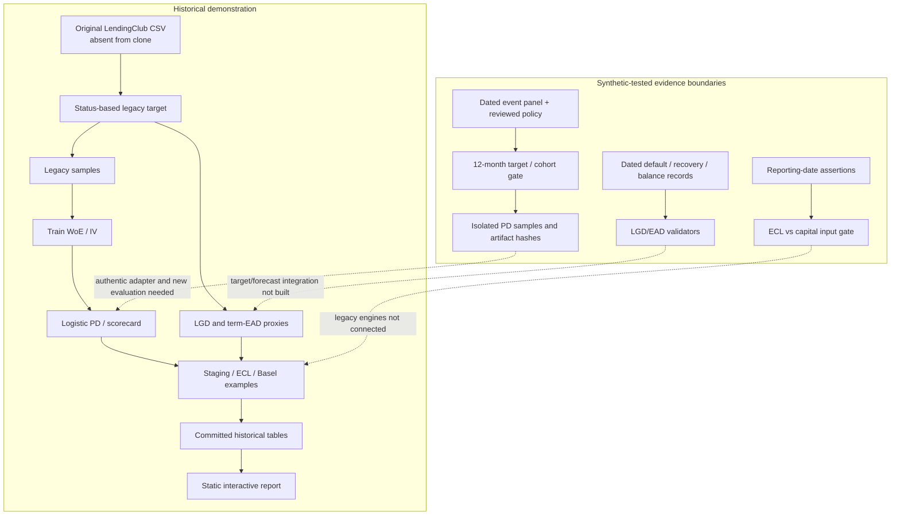

# Retail Credit Risk — Project Blueprint

**A source-grounded guide from credit-risk basics to evidence-aware modelling.**
**Status:** Python portfolio demonstration; corrected data contracts tested on synthetic records; original loan data and model artifacts unavailable; historical ECL/capital outputs unverified. Read the [README](README.md) for the short project overview.

## Contents

1. [The question and the vocabulary](#1-the-question-and-the-vocabulary)
2. [Architecture and evidence flow](#2-architecture-and-evidence-flow)
3. [Data provenance and reproducibility boundary](#3-data-provenance-and-reproducibility-boundary)
4. [A defensible 12-month PD target](#4-a-defensible-12-month-pd-target)
5. [From features to PD and points](#5-from-features-to-pd-and-points)
6. [Validation, calibration and stability](#6-validation-calibration-and-stability)
7. [LGD: what is lost after default](#7-lgd-what-is-lost-after-default)
8. [EAD: what is outstanding when default occurs](#8-ead-what-is-outstanding-when-default-occurs)
9. [Expected loss and accounting ECL](#9-expected-loss-and-accounting-ecl)
10. [Basel capital illustrations](#10-basel-capital-illustrations)
11. [Reporting-date evidence gate](#11-reporting-date-evidence-gate)
12. [Reporting, AI and repository tour](#12-reporting-ai-and-repository-tour)
13. [Running and testing the project](#13-running-and-testing-the-project)
14. [What the historical calculations can and cannot show](#14-what-the-historical-calculations-can-and-cannot-show)
15. [Troubleshooting and the path to real validation](#15-troubleshooting-and-the-path-to-real-validation)

## 1. The question and the vocabulary

A lender must distinguish a borrower who might miss an obligation from the money actually at risk. The project models three related quantities and then demonstrates how accounting losses and capital formulas might use them. Their **reference date, horizon, population and unit must match** before they can be combined.

| Term | Meaning | Unit and timing |
|---|---|---|
| **Default** | A defined credit event, such as a documented qualifying delinquency or charge-off. Its date and definition matter. | Event date and type; a final status is not its date. |
| **PD** | Probability of a defined default over a stated future window, conditional on being at risk at its start. | Fraction in [0,1]; e.g. next 12 months. |
| **LGD** | Fraction of exposure economically lost *if* default happens. | Fraction in [0,1] after recovery/cost treatment; workout may remain open. |
| **EAD** | Exposure expected or observed at default. | Currency amount; future exposure is different from today's balance. |
| **EL** | Simple unconditional expected-loss identity, $PD\times LGD\times EAD$. | Currency amount for aligned definitions; not automatically an accounting allowance. |
| **ECL** | Accounting estimate of discounted, probability-weighted cash shortfalls over the relevant default horizon. | Currency at a reporting date; stage and forward-looking evidence matter. |
| **RWA / capital** | Risk-weighted exposure and capital measures under a specified prudential rulebook. | Currency amounts, distinct from an observed bank capital *ratio*. |
| **Decision date / reporting date** | When a lending decision was made / when an exposure is measured for financial or capital reporting. | Different clocks. Training labels can mature later; model inputs cannot look forward. |

For an introductory toy loan, $PD=0.04$, $LGD=0.40$ and $EAD=\$1{,}000$ give $\$16$ by the **undiscounted identity**. This is **synthetic arithmetic**, not a computed IFRS 9 provision, Basel expected loss or a LendingClub result. A real calculation requires matching horizons, conditional cash flows, evidence as of the reporting date and framework-specific treatment.

## 2. Architecture and evidence flow

The repository has a historical modelling/reporting lane and newer, separate evidence contracts. The latter deliberately do **not** recalculate the committed results.



| Directory | Responsibility | Representative source |
|---|---|---|
| [`src/creditrisk/data/`](src/creditrisk/data) | Legacy target, reviewed policy, dated PD labels/cohorts, LGD/EAD records, sample/parameter hashes | [`pd_foundation.py`](src/creditrisk/data/pd_foundation.py), [`pd_artifacts.py`](src/creditrisk/data/pd_artifacts.py) |
| [`features/`](src/creditrisk/features) | Numeric/categorical WoE, IV and fit-only bin rules | [`binning.py`](src/creditrisk/features/binning.py) |
| [`models/`](src/creditrisk/models) | Logistic PD, points, recalibration, two-part LGD, term EAD proxy, synthetic CCF | [`pd_model.py`](src/creditrisk/models/pd_model.py), [`lgd_model.py`](src/creditrisk/models/lgd_model.py) |
| [`validation/`](src/creditrisk/validation) and [`monitoring/`](src/creditrisk/monitoring) | Discrimination, calibration, PSI/CSI, vintages and transition proxies | [`metrics.py`](src/creditrisk/validation/metrics.py), [`stability.py`](src/creditrisk/validation/stability.py) |
| [`regulatory/`](src/creditrisk/regulatory) | Historical ECL/Basel illustrations and separate reporting-date gate | [`ecl.py`](src/creditrisk/regulatory/ecl.py), [`reporting_input_gate.py`](src/creditrisk/regulatory/reporting_input_gate.py) |
| [`reporting/`](src/creditrisk/reporting) and [`ai/`](src/creditrisk/ai) | Static dashboard generation, optional retrieval-assisted CLI | [`build_panels.py`](src/creditrisk/reporting/build_panels.py), [`analyst.py`](src/creditrisk/ai/analyst.py) |
| [`config/`](config), [`tests/`](tests), [`outputs/`](outputs) | Historical assumptions, unit/synthetic fixtures, preserved tables/report | [`sampling.yaml`](config/sampling.yaml), [`validation_summary.csv`](outputs/tables/validation_summary.csv) |

The code uses Python 3.11+, pandas, NumPy, statsmodels, scikit-learn, SciPy, PyYAML and Parquet support. The dashboard is generated HTML/JavaScript using embedded data; the optional AI layer adds PDF parsing, embeddings and a Gemini API client. [Declared dependencies](pyproject.toml) describe possible full execution, not what was installed or run for this documentation pass.

## 3. Data provenance and reproducibility boundary

The historical scripts refer to `datasets/loan_data_2007_2014.csv`. The file, `datasets/` directory, processed Parquet samples and fitted PD/LGD pickle artifacts are **absent** from this fresh clone; [`.gitignore`](.gitignore) excludes raw and generated data. The committed [data inventory](outputs/reports/data_inventory.txt) *reports* 466,285 rows and 75 columns, but cannot authenticate its source bytes, licence, extraction date or SHA-256. A public file with a similar name or row count—including one used in another repository—is not established as the same snapshot. [The provenance review](docs/PD_TARGET_FOUNDATION.md) lists possible public source leads without claiming a match.

The old data path was raw inventory → [`target.py`](src/creditrisk/data/target.py) → sampling → [train-only binning](src/creditrisk/features/run_binning.py) → [PD fit](src/creditrisk/models/run_pd_model.py) → [validation](src/creditrisk/validation/run_validation.py) → saved CSVs. The *current* [`run_sampling.py`](src/creditrisk/data/run_sampling.py) instead requires normalized event JSONL, a reviewed policy, exact input SHA-256 and chronological cohorts; it writes isolated ignored `data/pd_evidenced/` samples. [Artifact binding](src/creditrisk/data/pd_artifacts.py) rejects a changed sample or stale model/bin file. A hash catches accidental substitution after a source is chosen; it does **not** prove that source's truth.

| Evidence level | Present here? | What it can support |
|---|---|---|
| Source code and configurations | Yes | Inspectable implementation and assumptions. |
| Synthetic/unit tests | Yes | Behavior on fabricated boundary examples. |
| Saved historical CSV/HTML outputs | Yes | What an earlier run reported, not its reproducibility or validity. |
| Original dataset, event ledger, reporting panel and fitted artifacts | No | No independent real-data metric or regulatory calculation can be reproduced. |
| Regulator- or auditor-approved model and rulebook mapping | No | No production or compliance conclusion. |

## 4. A defensible 12-month PD target

### Outcome and observation window

The legacy [`target.py`](src/creditrisk/data/target.py) calls a final `loan_status` default-like, estimates its date as `last_pymnt_d + 3 months` and assigns zero to unresolved rows. A last payment is not a confirmed default event, and an unresolved loan is not a known non-default. The corrected [`pd_foundation.py`](src/creditrisk/data/pd_foundation.py) supplies the target contract; it has been tested on synthetic records only.

Let **D** be origination date and **A = D + 12 calendar months**. The performance interval is **(D, A]**. `default_12m = 1` needs the earliest *confirmed* qualifying event (90+ DPD, charge-off, bankruptcy or unlikeliness to pay) after D and by A, with date, type and source. `default_12m = 0` needs observation through A **and** an explicit source assertion that qualifying-event history is complete through that date. All other cases receive `None` and a disposition such as censored or undated default. A current charged-off status alone never establishes a 12-month positive.

**Synthetic boundary example.** A loan originated 31 January 2024 has an anniversary of 31 January 2025. A documented first default on 31 January 2025 is in-window. An event on 1 February 2025 is outside; it supports a zero only if the entire earlier event history is complete. If observation stopped in December 2024, the outcome is unknown even when the last observed status was current. For 29 February 2024, the code clamps the next anniversary to 28 February 2025.

[`PDPolicy`](src/creditrisk/data/pd_foundation.py) defines named, non-overlapping issue-date cohorts `[start, end)`, an `as_of_date`, approved predictors and a 12-month period. [`build_model_rows`](src/creditrisk/data/pd_foundation.py) admits only observed binary labels, counts exclusions, requires chronological train/test/OOT ordering and a maturation gap. A 2014 issue year is only an **OOT cohort by origination date**; without verified 12-month follow-up and untouched model selection it is not an independent performance study. [The original split](src/creditrisk/data/sampling.py) used 2007–2013 development, random stratified train/test and 2014 OOT according to [`sampling.yaml`](config/sampling.yaml); those old labels remain invalid for a corrected PD.

### Decision-time features and leakage

Predictors need per-row availability timestamps at or before `decision_at`, approval under the policy and exclusion of identifiers, servicing fields and outcomes. `loan_status`, `recoveries`, `out_prncp`, `last_pymnt_d` and future observation fields cannot be application-time predictors. [`variables.yaml`](config/variables.yaml) is a historical candidate dictionary, not proof that `grade`, `int_rate` or funded amounts were known *before the chosen lending decision*. Model B includes platform grade/pricing signals; interpret it as a benchmark using those signals until timing is established. [The corrected sampler](src/creditrisk/data/run_sampling.py) keeps this evidence separate from the legacy target and reports exclusions. Its source-specific adapter is still missing.

## 5. From features to PD and points

### WoE and information value

For a bin $b$, let $g_b$ and $d_b$ be non-default and default counts; $G,D$ are their training totals and $K$ is the number of bins. The fitted [`WoEBinner`](src/creditrisk/features/binning.py) uses half-count smoothing:

$$
p_{g,b}=\frac{g_b+0.5}{G+0.5K},\quad p_{d,b}=\frac{d_b+0.5}{D+0.5K},\quad WoE_b=\ln\!\left(\frac{p_{g,b}}{p_{d,b}}\right),\quad IV=\sum_b(p_{g,b}-p_{d,b})WoE_b.
$$

Positive WoE means that bin has a larger share of goods than bads; with a negative coefficient in a bad-event logistic model, it lowers predicted PD. IV summarises separation in the **fit sample** and is not causal importance. The implementation starts numeric variables with quantile bins, merges adjacent bins toward minimum size/monotonic WoE, pools rare categories into `OTHER`, and gives nulls a `MISSING` bin. It fits on training rows; later rows reuse those rules. Missing or unseen bins without fitted WoE now raise clear errors instead of receiving silent scores. [Train-only runner](src/creditrisk/features/run_binning.py), [synthetic checks](tests/test_binning.py).

**Synthetic WoE example.** Suppose bin A has 40 goods/10 bads and bin B has 20 goods/30 bads. With $G=60$, $D=40$, $K=2$, the smoothed WoE values are about **+0.95** and **−0.79**, respectively. The resulting IV is about **0.71**—an intentionally strong toy separation, not a measured repository feature. Both denominators use training totals, never test or OOT totals.

### Logistic regression and model variants

[`PDModel`](src/creditrisk/models/pd_model.py) selects variables above the configured IV threshold, checks the static feature allowlist, rejects censored/nonbinary targets and fits `statsmodels.Logit` on train-fitted WoE features. With intercept $\beta_0$ and coefficients $\beta_j$:

$$
z=\beta_0+\sum_j\beta_j WoE_j,\qquad PD=\sigma(z)=\frac{1}{1+e^{-z}}.
$$

For **synthetic** $\beta_0=-3$, $\beta_1=-0.8$ and $WoE_1=0.5$, $z=-3.4$ and $PD\approx0.0323$. A higher good:bad WoE lowers PD when its coefficient is negative. The code flags positive coefficient signs for review. [`pd_model.yaml`](config/pd_model.yaml) defines Model A without `grade`, `sub_grade` or `int_rate`; Model B permits those signals and drops two historically unstable variables. The old saved A/B metrics do not validate either model under the corrected label. [`calibration.py`](src/creditrisk/models/calibration.py) provides intercept and Platt adjustments; the old test-set recalibration rows are fit-sample diagnostics, not untouched test evidence.

### Scorecard scaling

The [scorecard](src/creditrisk/models/scorecard.py) maps **higher scores to lower bad odds**. With $O=(1-PD)/PD$ (good:bad odds), target score $S_0=600$ at odds $O_0=50$ and points-to-double-odds $PDO=20$ from [`pd_model.yaml`](config/pd_model.yaml):

$$
F=\frac{PDO}{\ln2},\quad S=S_0+F\ln(O/O_0)=\underbrace{S_0-F\ln O_0}_{\text{offset}}-Fz.
$$

The code distributes offset/intercept over $m$ selected features and assigns each bin $(\text{offset}-F\beta_0)/m-F\beta_j WoE_{j,b}$ points, rounded to an integer. With **synthetic** $PD=0.02$, $O=49$ and the stated scale, the unrounded score is about **599.4**. Summing rounded bin points can differ from the logistic-implied unrounded score by at most about $m/2$ points. Scoring rejects absent columns or bins without points; [Phase 4 tests](tests/test_scorecard.py) check score/PD consistency within rounding tolerance. [Rating grades](src/creditrisk/models/scorecard.py) are score quantiles fitted to the supplied sample, not an independently validated master scale.

## 6. Validation, calibration and stability

**Discrimination** asks whether higher PD tends to rank defaulters above non-defaulters. [Metrics code](src/creditrisk/validation/metrics.py) computes area under the ROC curve (AUC), $Gini=2AUC-1$, and the maximum separation between cumulative default/non-default distributions (KS). AUC 0.5 is chance ranking in the usual interpretation; it says nothing by itself about whether a stated 4% PD occurs 4% of the time. Phase 4 changed KS to evaluate a tied prediction group at one attainable threshold instead of splitting that group mid-way.

**Calibration** compares predicted frequencies with observed frequencies under a valid target. Brier score is $n^{-1}\sum_i(p_i-y_i)^2$; lower is better, but compare it with a prevalence-only baseline and uncertainty. [Calibration tables](src/creditrisk/validation/metrics.py) show mean PD versus outcome rate by quantile bin; bins are recomputed per sample in the historical implementation, so row 1 in different cohorts is not a frozen score band. The Hosmer–Lemeshow statistic is a grouped goodness-of-fit diagnostic, not a certification; large samples can reject small departures, and non-rejection cannot prove correctness. [Intercept/Platt recalibration](src/creditrisk/models/calibration.py) must be fitted on a designated calibration set and evaluated separately; a metric on its own fit rows is not out-of-sample validation.

**Time separation** matters as much as metric choice. Fit bins, IV selection, logistic parameters, grade cutoffs and any calibration layer on designated training/calibration evidence. Reserve a truly later, label-mature cohort once for final assessment; do not choose the winner on that same cohort. Report population, exclusions, prevalence, confidence intervals, fixed-bin calibration and model/version hashes. The saved [validation table](outputs/tables/validation_summary.csv) records historical train/test/OOT figures under the invalid old label; it does not establish generalisation of the corrected path.

**Stability** asks a different question: has the scored population shifted? [PSI](src/creditrisk/validation/stability.py) uses reference-score quantile edges and, for each bin, $(a_b-e_b)\ln(a_b/e_b)$ for actual/reference shares with a small zero guard. CSI applies similar distribution comparisons to feature bins. For **synthetic** two-bin shares $(0.5,0.5)$ versus $(0.6,0.4)$, PSI is about **0.041**. A low PSI cannot prove calibration; a high PSI does not identify the cause. The code's 0.10/0.25 bands are heuristic labels, **not universal regulatory mandates**. Historical categorical CSI has a separate null-handling path; inspect it before using it for a decision. [Vintages](src/creditrisk/monitoring/vintage.py) and [transition/roll-rate modules](src/creditrisk/monitoring/transitions.py) add portfolio views, but their source timestamps/status progression are not authenticated here.

## 7. LGD: what is lost after default

### The two-part model and its historical target

For a resolved default, economic LGD ordinarily needs **exposure at the default date**, dated recovery payments, relevant workout costs, discount convention and a defensible end of workout. The historical [`lgd_data.py`](src/creditrisk/models/lgd_data.py) instead computes

$$
EAD_{proxy}=\max(\text{funded amount}-\text{total principal ever received},0),\qquad LGD_{proxy}=\operatorname{clip}\left(\frac{\max(EAD_{proxy}-\text{aggregate recoveries},0)}{EAD_{proxy}},0,1\right).
$$

This is a **cumulative-field proxy**: later principal receipts can change the supposed default balance; recovery dates, costs and workout completion are absent. Missing cumulative values become zero, and zero-denominator rows are assigned LGD 0, so saved averages are not measured economic loss. The [LGD/EAD foundation guide](docs/LGD_EAD_DATA_FOUNDATION.md) explains the corrected evidence boundary.

The actual [`TwoStageLGD`](src/creditrisk/models/lgd_model.py) is a **hurdle model**, not a fractional-response GLM. A training-fitted WoE representation feeds (1) logistic $P(\text{positive recovery})$ and (2) gradient-boosted predicted recovery rate conditional on positive recovery. Its combined output is

$$
\widehat{LGD}=\operatorname{clip}\left[1-\widehat{P}(R>0)\widehat{E}(R/EAD\mid R>0),\,0,\,1\right].
$$

The identity is sensible **if** both labels represent completed, correctly dated workouts. Historical [training](src/creditrisk/models/run_lgd_training.py) uses a random split and old target; its recovery-classifier AUC is computed on fit rows, and no later-vintage/complete-workout validation is established.

### Dated workout contract and synthetic economic example

[`validate_lgd_record`](src/creditrisk/data/lgd_ead_foundation.py) requires a documented first qualifying default, positive exposure at that event, explicit dated recoveries and workout costs, a sourced annual rate, observation endpoint and explicit closure status. Recovery/cost dates must lie within the observed default-to-workout interval. An open workout is admissible evidence but has `label_eligible=False`; a missing ledger is never interpreted as zero recovery. The function returns validated **cash flows**, not a computed LGD. [Contract guide](docs/LGD_EAD_DATA_FOUNDATION.md) and [synthetic tests](tests/test_lgd_ead_foundation.py).

**Synthetic calculation outside the validator:** Default-date exposure $\$1{,}000$, recovery $\$200$ and cost $\$20$ one year later, annual effective discount rate 10%. Net present recovery at default is $(200-20)/1.10=\$163.64$, giving $LGD\approx1-163.64/1000=0.8364$. Different cash-flow dates, cures, excess recoveries and cost policies need explicit treatment. No such dated computation or real-data estimate has been performed here.

## 8. EAD: what is outstanding when default occurs

For a term loan, default-date balance differs from initial funded amount and from an arbitrary current statement balance. [Historical `ead_model.py`](src/creditrisk/models/ead_model.py) uses `max(funded_amnt − total_rec_prncp, 0)` for loans marked ever-default and `max(out_prncp, 0)` for others. Those fields are not aligned to one reporting date or a verified default event; there is no fitted term-loan EAD forecast. The ratio of this proxy to funded amount is **not** a credit conversion factor.

For a revolving commitment, let $D_0$ be drawn at an observation date, $U_0$ undrawn, and $D_{def}$ observed at default. A realized stable-limit conversion factor is $(D_{def}-D_0)/U_0$ when $U_0>0$ and the limit/reconciliation conditions hold. A forecast may use $EAD=D_0+CCF\cdot U_0$. In a **synthetic** account with $D_0=\$400$, $U_0=\$600$ and $D_{def}=\$640$, realized CCF is $0.4$ and EAD is $\$640$. The separate [CCF demo](src/creditrisk/models/ccf_demo.py) generates synthetic revolving accounts and fits an in-sample linear predictor; it is not evidence from these term loans.

[`validate_ead_record`](src/creditrisk/data/lgd_ead_foundation.py) requires observation/decision/default/as-of timestamps in order; non-negative drawn balances; and, for revolvers, reconciled drawn+undrawn limits. It returns the observed default balance and a realized CCF only for stable-limit, positive-undrawn, non-negative draw cases. Limit changes, no undrawn commitment and net repayment produce an explicit ineligibility reason. Term loans have no CCF. **Prospective** EAD for ECL or capital still needs a reporting-date balance and supported future amortisation/draw assumptions; a realized default balance is an outcome label, not a forecast.

## 9. Expected loss and accounting ECL

### Arithmetic versus a reporting-date allowance

The simple identity $PD\times LGD\times EAD$ is a useful one-period teaching approximation if definitions align. A provision under [Ind AS 109 §5.5](https://www.mca.gov.in/Ministry/pdf/IndAS109_2020_10112020.pdf) / IFRS 9 instead measures probability-weighted **cash shortfalls discounted to the reporting date** using the effective interest rate or an appropriate approximation. In particular, **12-month ECL is the lifetime shortfall arising from defaults possible in the next 12 months**, not merely cash missed during those 12 months. A lifetime PD is not an additive monthly series by itself.

For a default-time teaching model, let $q_t$ be conditional default probability in period $t$, $S_{t-1}=\prod_{j<t}(1-q_j)$ survival to its start and $mPD_t=S_{t-1}q_t$ marginal default probability. An illustrative scenario sum is

$$
\text{ECL}_{illustrative}=\sum_s w_s\sum_{t\in H}mPD_{s,t}\,LGD_{s,t}\,EAD_{s,t}\,DF_{s,t},\qquad \sum_s w_s=1.
$$

Here $H$ contains default periods for the stage's horizon. The expression is valid only if LGD represents the relevant **post-default lifetime cash shortfall** at a stated valuation point, EAD represents exposure at those defaults, and `DF` moves that shortfall to the reporting date **exactly once**. A full implementation can instead model contractual versus expected cash flows directly. In a **synthetic, undiscounted one-period** simplification with $PD=.04$, $LGD=.40$, $EAD=\$1{,}000$, the product is $\$16$; scenario weights $0.5/0.3/0.2$ over $\$16/\$24/\$12$ yield $\$17.60$. Neither example is a provision produced by this repository.

### Stages, SICR and what the old engine does

| Accounting concept | Intended question | Historical code and limitation |
|---|---|---|
| **Stage 1** | Has credit risk *not* increased significantly since initial recognition? Measure 12-month ECL. | [`staging.py`](src/creditrisk/regulatory/staging.py) assigns the residual performing group after fixed thresholds/status matching. It lacks authenticated initial/current lifetime-risk evidence. |
| **Stage 2** | Significant increase in credit risk (SICR), without credit impairment? Measure lifetime ECL. | Code compares current 12-month PD to a same-portfolio grade mean of **current** PD as an origination proxy, or a fixed absolute threshold. This is circular and not a demonstrated initial-versus-current expected-life comparison. |
| **Stage 3** | Credit-impaired exposure? Measure lifetime ECL with appropriate discounted cash-shortfall treatment. | Code uses `ever_default` or final statuses, including `Late (31-120 days)`, then [`ecl.py`](src/creditrisk/regulatory/ecl.py) applies undiscounted $LGD\times EAD$. A 31-day delinquency is not automatically Stage 3. |

The standard's more-than-30-days-past-due SICR presumption is **rebuttable** and separate from the default/credit-impairment assessment. The code's any-`Late` string check also catches 16–30 DPD. [Historical `ifrs9.yaml`](config/ifrs9.yaml) values are illustrative choices, not validated staging policy. [The lifetime curve](src/creditrisk/regulatory/lifetime_pd.py) retains censored/fully paid loans in later risk sets and does not condition account lifetime risk on survival to a reporting date. [The ECL engine](src/creditrisk/regulatory/ecl.py) uses one midpoint discount, may substitute 12% interest, 0.93 LGD or a synthetic term curve, and does not project dated shortfalls. [Scenario code](src/creditrisk/regulatory/macro_scenarios.py) multiplies PD by configured factors and weights, holding stage/LGD/EAD fixed. Those are transparent **sensitivity illustrations**, not an empirically supported forward-looking allowance.

## 10. Basel capital illustrations

Accounting ECL estimates a loss allowance; Basel risk-weighted assets and capital requirements address a separate prudential purpose. The other-retail *performing* IRB example in [`basel_capital.py`](src/creditrisk/regulatory/basel_capital.py) follows the recognizable Gaussian shape in [BIS CRE31](https://www.bis.org/committees/bcbs/basel-framework/standard/cre/31/inforce/2023-01-01/published/2020-03-27):

$$
R=0.03f(PD)+0.16[1-f(PD)],\quad f(PD)=\frac{1-e^{-35PD}}{1-e^{-35}},
$$
$$
K=LGD\,\Phi\!\left(\frac{\Phi^{-1}(PD)+\sqrt R\,\Phi^{-1}(0.999)}{\sqrt{1-R}}\right)-PD\,LGD,\qquad RWA=12.5\,K\,EAD.
$$

$\Phi$ is the standard normal CDF and $\Phi^{-1}$ its inverse. $K$ is the illustrative capital fraction of EAD after expected loss subtraction; it is **not** the simple accounting EL. A **synthetic arithmetic** example: if a separately justified calculation gives $K=0.10$ and $EAD=\$1{,}000$, then $RWA=\$1{,}250$ and 8% of that selected credit RWA is $\$100$. This is not a bank's observed total-capital ratio: the project has no bank capital numerator, full-bank RWA, buffers or output-floor analysis.

The code also applies $0.75\times EAD$ as a flat [standardised](src/creditrisk/regulatory/basel_capital.py) comparison, and adds eight percentage points to LGD as a downturn sensitivity. Neither assumption is evidenced as eligible/calibrated for this portfolio. The code's 0.03% PD floor conflicts with the 0.05% floor for non-sovereign exposures in the [2023-in-force BIS CRE32 text](https://www.bis.org/committees/bcbs/basel-framework/standard/cre/32/inforce/2023-01-01/published/2020-03-27); [CRE20](https://www.bis.org/committees/bcbs/basel-framework/standard/cre/20/inforce/2023-01-01/published/2020-11-26) makes retail standardised weights conditional on eligibility. Defaulted IRB exposures have a different treatment; the old performing $K$ is applied too broadly. A specific bank would need a named **jurisdiction, effective rule version, exposure class, supervisory permission, floors and default treatment** before using these equations for capital reporting. No such applicability is established for historical US LendingClub loans.

## 11. Reporting-date evidence gate

The standalone [`reporting_input_gate.py`](src/creditrisk/regulatory/reporting_input_gate.py) makes the clocks and parameter bases explicit. It accepts an ISO reporting date and timezone-aware cutoff, same-day status with observation/**availability** timestamps, matching loan IDs, currency and `currency_units`. Every supplied PD/LGD/EAD estimate has a named source and timestamps no later than the cutoff; the gate rejects omitted, extra, negative, non-finite, future, out-of-order or incompatible evidence rather than inventing values.

| Path admitted for an **illustration** | Additional required basis |
|---|---|
| ECL Stage 1 | Forward PD from reporting date to earlier of 12 months and expected life; prospective economic LGD, prospective default exposure, dated initial/current risk comparison, EIR and scenario sources. |
| ECL Stage 2 | Forward PD from reporting date through expected life, plus the same dated loss/risk evidence. |
| Performing other-retail IRB | One-year regulatory PD, regulatory downturn LGD, regulatory default exposure, named effective rulebook/retail eligibility and IRB authorisation assertions. |
| Performing standardised retail | Regulatory exposure and named effective rulebook/retail eligibility; IRB PD/LGD/authorisation must be absent. |

**Stage 3 and defaulted capital fail closed** pending distinct cash-shortfall/default-treatment contracts. Passing the gate proves only internal shape and timing of supplied assertions. It cannot authenticate a source, judge SICR, calibrate economic/regulatory parameters, validate scenario probabilities, verify supervisor approval or fix the legacy engines. It is **not wired into** historical runners. The full [input schema and limitations](docs/REPORTING_DATE_INPUT_GATE.md) and [synthetic tests](tests/test_reporting_input_gate.py) are the implementation references.

## 12. Reporting, AI and repository tour

[`build_panels.py`](src/creditrisk/reporting/build_panels.py) reads committed CSVs, serialises table records into generated HTML and writes both [`index.html`](index.html) and [`docs/index.html`](docs/index.html). Its JavaScript presents an executive analytics view with panels and an expandable pipeline map; charts use Chart.js. The current committed pages are **static artifacts of historical tables**, not a live model service. They do not query a database or demonstrate authenticated ECL/capital. The browser fetches Chart.js and fonts from external CDNs, so offline rendering can be partial. A separate [`dashboard_data.py`](src/creditrisk/reporting/dashboard_data.py) can consolidate table summaries into JSON; [`dashboard_data.json`](outputs/reports/dashboard_data.json) is another saved artifact.

The optional AI layer is separate from credit scoring. [`rag_index.py`](src/creditrisk/ai/rag_index.py) reads local PDFs page by page, chunks text and stores `chunks.json` and NumPy embeddings. [`retriever.py`](src/creditrisk/ai/retriever.py) uses cosine similarity over those embeddings; it does **not** use a committed FAISS index. [`analyst.py`](src/creditrisk/ai/analyst.py) passes retrieved context and calculation tools to a configured Gemini model; [`run_analyst.py`](src/creditrisk/ai/run_analyst.py) is the CLI. The required `knowledge_base/` PDFs, built `outputs/models/rag_index/` and API key are not included. This documentation pass inspected source but did not call an AI service or verify an answer/citation. Tool outputs inherit the illustrative math limitations of the functions they call.

The older [walkthrough source pack](RETAIL_CREDIT_RISK_WALKTHROUGH_SOURCEPACK.md), [long-form presentation script](RETAIL_CREDIT_RISK_ZERO_TO_GOD_MODE_MASTER_WALKTHROUGH_PLAIN_PREVIEW.md), [SME map](RETAIL_CREDIT_RISK_SME_MAP.md), [project snapshot](PROJECT_TRUTH_retail-credit-risk.md) and [archived model manual](docs/archive/MODEL_DOCUMENTATION.md) preserve original explanations and results. Several contain source paths from a former workspace, production/regulatory language and unreproduced metrics. Use this blueprint and the focused [PD target](docs/PD_TARGET_FOUNDATION.md), [PD corrections](docs/PD_MODEL_CORRECTIONS.md), [LGD/EAD](docs/LGD_EAD_DATA_FOUNDATION.md) and [reporting gate](docs/REPORTING_DATE_INPUT_GATE.md) guides for current status.

## 13. Running and testing the project

### What runs without the original dataset

Open [`index.html`](index.html) directly to inspect the saved report; its charts may need a network connection for CDN assets. The three evidence-contract test files use the Python standard library. From the repository root with an available Python 3.11+ interpreter:

```powershell
$env:PYTHONPATH = 'src'
python -m unittest discover -s tests -p test_pd_foundation.py -v
python -m unittest discover -s tests -p test_lgd_ead_foundation.py -v
python -m unittest discover -s tests -p test_reporting_input_gate.py -v
```

In Phase 8 these suites passed **11 + 23 + 12 = 46** synthetic tests. That count is a record of the specified suites at that commit, not a claim that the entire repository test suite or end-to-end pipeline passed in this documentation pass. Additional tests under [`tests/`](tests) exercise legacy arithmetic and model components; some require dependencies declared in [`pyproject.toml`](pyproject.toml). No dependency installation or model training is needed to read this manual.

### Conditional corrected-PD workflow

Only after obtaining a legitimate dated event panel, write a source-specific adapter that outputs the normalized JSONL fields in [the PD contract](docs/PD_TARGET_FOUNDATION.md), and a reviewed JSON policy containing `as_of_date`, chronological `cohorts`, `approved_features`, `selected_features`, `source_description` and exact `input_sha256`. These inputs are **not included**. The code path is:

```powershell
$env:PYTHONPATH = 'src'
python -m creditrisk.data.run_sampling --evidence-jsonl <dated-events.jsonl> --policy <reviewed-policy.json>
python -m creditrisk.features.run_binning
python -m creditrisk.models.run_pd_model
python -m creditrisk.validation.run_validation
```

The commands above describe the existing runner order, **not an executable demo from this clone**. The sampler checks the hash and target/cohort evidence, then writes `data/pd_evidenced/` and its manifest; later runners require matching artifacts under `outputs/pd_evidenced/`. They should be used only after source authentication, decision-time feature review and a frozen validation design. The legacy LGD/EAD and regulatory runners still consume old proxy definitions and must not be chained onto a corrected PD fit as if they were validated.

### Configuration and tests by question

| Question | Read / run |
|---|---|
| What are the original candidate predictors and exclusions? | [`variables.yaml`](config/variables.yaml), [`pd_model.yaml`](config/pd_model.yaml), [`schema.py`](src/creditrisk/data/schema.py) |
| How are old vintages split? | [`sampling.yaml`](config/sampling.yaml), [`sampling.py`](src/creditrisk/data/sampling.py); historical only. |
| Where are old staging and macro assumptions? | [`ifrs9.yaml`](config/ifrs9.yaml), [`macro_scenarios.yaml`](config/macro_scenarios.yaml); illustrative, uncalibrated. |
| Which PD boundaries are synthetic-tested? | [`test_pd_foundation.py`](tests/test_pd_foundation.py), [`test_pd_sampling_runner.py`](tests/test_pd_sampling_runner.py), [`test_scorecard.py`](tests/test_scorecard.py). |
| Which workout/exposure and reporting boundaries are tested? | [`test_lgd_ead_foundation.py`](tests/test_lgd_ead_foundation.py), [`test_reporting_input_gate.py`](tests/test_reporting_input_gate.py). |
| Where are the saved, unreproduced numbers? | [`outputs/tables/`](outputs/tables), [`outputs/reports/`](outputs/reports). |

## 14. What the historical calculations can and cannot show

The historical outputs are valuable as an inspectable record of a multi-module credit-risk demonstration. They do **not** form one audited or consistently reproducible regulatory run. Examples:

| Saved artifact | What it records | Why it cannot currently support a stronger claim |
|---|---|---|
| [`validation_summary.csv`](outputs/tables/validation_summary.csv) | Old Model B OOT AUC **0.6923** / Gini **0.3845**. | Old target infers timing from final status/latest payment; source, follow-up, fit artifacts and independent selection are unavailable. |
| [`lgd_distribution_summary.csv`](outputs/tables/lgd_distribution_summary.csv), [`ead_summary.csv`](outputs/tables/ead_summary.csv) | Historical recovery and term-balance proxy summaries. | No dated default balance, recovery-cost ledger, workout completion or real revolving limits. |
| [`ecl_summary.csv`](outputs/tables/ecl_summary.csv), [`basel_capital_summary.csv`](outputs/tables/basel_capital_summary.csv) | Outputs of illustrative legacy ECL and Basel formulas. | Inconsistent reporting dates/parameter bases, staging/lifetime/discount and regulatory-eligibility issues described above. |
| [`ecl_scenario_weighted.csv`](outputs/tables/ecl_scenario_weighted.csv), [`expected_loss_summary.csv`](outputs/tables/expected_loss_summary.csv) | Committed small-example outputs. | The former is consistent with a three-loan synthetic test, not the README's old full-portfolio scenario total; the latter is also a small fixture. Do not reconcile them as one portfolio run. |
| [`SYNTHETIC_ccf_summary.csv`](outputs/tables/SYNTHETIC_ccf_summary.csv) | Explicitly synthetic revolving CCF exercise. | The historical term-loan snapshot cannot calibrate revolving line draw behaviour. |

**No production or regulatory certification follows.** The [reporting-date guide](docs/REPORTING_DATE_INPUT_GATE.md) and source identify material defects in SICR/staging, survival-conditioned lifetime PD, EIR/cash-flow discounting, scenario evidence, defaulted capital treatment and rule-version/eligibility assumptions. The standalone gate checks input plausibility but does not alter those calculations. Saved figures should be introduced as *historical artifacts under legacy assumptions*, with no implied real-data verification.

## 15. Troubleshooting and the path to real validation

| Symptom | Likely cause and next check |
|---|---|
| `ModuleNotFoundError: creditrisk` in a foundation test | Run at repo root with `$env:PYTHONPATH = 'src'`, or use an already configured editable environment. |
| Historical runner cannot find a CSV, Parquet file or pickle | Those inputs are absent from the clone. Do not create placeholder files or reuse a similar dataset; check [provenance](#3-data-provenance-and-reproducibility-boundary). |
| Corrected sampler rejects schema, cohort, hash or observation window | Inspect the normalized event record and reviewed policy; unknown/censored labels and future predictors must remain excluded. [Contract](docs/PD_TARGET_FOUNDATION.md). |
| Scorecard rejects an unseen category, missing column or point bin | The fitted bin map lacks an admissible route. Review the training-only WoE rules rather than assigning zero points. [Scoring code](src/creditrisk/models/scorecard.py). |
| LGD/EAD validator rejects a workout or CCF | Supply dated balances, cash flows, limits and explicit observation/closure evidence; incomplete workouts and ineligible CCF cases have different meanings. [Guide](docs/LGD_EAD_DATA_FOUNDATION.md). |
| Reporting gate rejects an ECL/IRB/standardised record | Check reporting cutoff, availability timestamps, loan ID, horizon, currency/unit, prospective versus realized basis, rulebook and approach-specific fields. [Guide](docs/REPORTING_DATE_INPUT_GATE.md). |
| Dashboard charts fail offline | The committed HTML references CDN-hosted Chart.js/fonts; open online for those assets. Values remain historical regardless of rendering. |
| AI CLI lacks an index or key | The PDFs and local embeddings are not bundled; the CLI requires a user-provided `GEMINI_API_KEY` and a locally built index. It was not live-tested here. |

For a credible *real-loan* study, first obtain an authorised snapshot and dated event/servicing panel with source URL/terms, extraction date, schema and SHA-256. Reconcile loan IDs, earliest qualifying defaults, observation completion, default-date balances, recoveries, costs and reporting-date status. Document decision-time availability and freeze cohorts before fitting. Refit only eligible train data, calibrate without touching the final later cohort, then report uncertainty and baseline comparisons. Separately define scenario cash flows and effective interest rate for ECL; select a specific jurisdiction, effective rulebook, exposure eligibility and supervisory permissions for capital. Only then integrate the new contracts with corrected downstream engines and reconcile totals. None of this future evidence is claimed to exist now.
