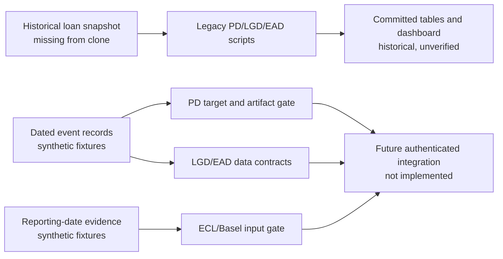

# Retail Credit Risk

**From dated loan evidence to credit scores, loss estimates and capital illustrations.**

This Python project explores the full retail credit-risk chain: **probability of default (PD)**, **loss given default (LGD)**, **exposure at default (EAD)**, scorecards, monitoring, accounting expected credit loss (ECL) and Basel-style capital formulas. Its strongest current contribution is an explicit boundary between *calculations that exist* and *evidence needed to trust them*.

> [!IMPORTANT]
> **Portfolio demonstration · synthetic-tested foundations · historical outputs unverified.** The original LendingClub CSV, dated earliest-default ledger, reporting-date account panel and fitted artifacts are absent. Saved performance and financial tables predate the corrected evidence contracts; they have not been reproduced on authenticated data. The ECL and Basel engines are illustrations, not validated allowances, regulatory capital or proof of compliance.

**[Read the technical blueprint →](PROJECT_BLUEPRINT.md)** · [Explore the interactive report](index.html) · [Inspect synthetic tests](tests) · [See historical tables](outputs/tables)

## What is implemented

| Layer | Source-backed capability | Evidence boundary |
|---|---|---|
| **PD and scorecard** | Train-fitted numeric/categorical [WoE and IV](src/creditrisk/features/binning.py), [statsmodels logistic PD](src/creditrisk/models/pd_model.py), [Model A/B selection](config/pd_model.yaml), good:bad odds and points-per-doubling [score scaling](src/creditrisk/models/scorecard.py), calibration and discrimination [metrics](src/creditrisk/validation/metrics.py). | A [dated 12-month target contract](src/creditrisk/data/pd_foundation.py) and [evidence-gated sampling/artifact path](docs/PD_MODEL_CORRECTIONS.md) are synthetic-tested; no corrected real-loan model fit exists. |
| **LGD and EAD** | Historical [two-part recovery model](src/creditrisk/models/lgd_model.py), [term-loan principal proxy](src/creditrisk/models/ead_model.py) and separate [synthetic revolving CCF example](src/creditrisk/models/ccf_demo.py). | [Dated default, workout and exposure validators](docs/LGD_EAD_DATA_FOUNDATION.md) are synthetic-tested. The historical proxies are not measured default-date balances or discounted economic LGD. |
| **ECL and capital** | [Stage assignment](src/creditrisk/regulatory/staging.py), [lifetime curve/ECL](src/creditrisk/regulatory/ecl.py), [scenario weighting](src/creditrisk/regulatory/macro_scenarios.py) and [IRB/standardised arithmetic](src/creditrisk/regulatory/basel_capital.py). | The [reporting-date input gate](docs/REPORTING_DATE_INPUT_GATE.md) separately validates illustrative accounting and capital evidence. It is not connected to the legacy engines; their regulatory interpretations and saved totals remain unvalidated. |
| **Monitoring and reporting** | [PSI/CSI](src/creditrisk/validation/stability.py), [vintage](src/creditrisk/monitoring/vintage.py), [transition/roll-rate proxies](src/creditrisk/monitoring/transitions.py), a [table-to-HTML report builder](src/creditrisk/reporting/build_panels.py) and committed [static interactive report](index.html). | The report displays embedded historical tables; charts do not authenticate their underlying data. Browser charts/fonts use external CDNs. |
| **Optional AI analyst** | A [Gemini CLI](src/creditrisk/ai/run_analyst.py) with [PDF retrieval and calculation-tool wiring](src/creditrisk/ai/analyst.py). | Requires a user-provided API key and locally built document index. No live AI response or regulatory citation was verified in this portfolio pass. |

## Evidence, precisely



- **Implemented:** modular model, scorecard, validation, monitoring, reporting and illustrative regulatory code exists in `src/creditrisk/`.
- **Synthetic-tested:** the new PD target/sampling safeguards, LGD/EAD dated contracts and reporting-date gate reject many invalid records. Tests establish software behavior on fabricated examples, not loan-level performance.
- **Historical saved results:** [`validation_summary.csv`](outputs/tables/validation_summary.csv) reports Model B out-of-time AUC **0.6923** under the old target; [`ecl_summary.csv`](outputs/tables/ecl_summary.csv) and [`basel_capital_summary.csv`](outputs/tables/basel_capital_summary.csv) preserve old ECL/RWA totals. Their source data, outcome coverage and downstream assumptions are not independently verified.
- **Regulatory illustrations:** Stage 2/3, lifetime ECL, discounting, scenario and capital calculations have material methodological gaps. A passing reporting-date gate does not certify the older engines. See the [audit and limits](PROJECT_BLUEPRINT.md#14-what-the-historical-calculations-can-and-cannot-show).

## Explore and reproduce what is possible

1. Open [the static report](index.html) to inspect the archived visualisation, or read the [output tables](outputs/tables). Its embedded figures are historical demonstrations. Chart.js and fonts are fetched from CDNs when online.
2. Read [PROJECT_BLUEPRINT.md](PROJECT_BLUEPRINT.md) for formulas, architecture, worked **synthetic** examples and an evidence-by-evidence walkthrough.
3. From the repository root, with Python 3.11+ available, run the standard-library foundation tests without data downloads or model training:

   ```powershell
   $env:PYTHONPATH = 'src'
   python -m unittest discover -s tests -p test_pd_foundation.py
   python -m unittest discover -s tests -p test_lgd_ead_foundation.py
   python -m unittest discover -s tests -p test_reporting_input_gate.py
   ```

The historical end-to-end runners need missing raw/processed data and model files. A corrected PD run additionally needs a reviewed, hashed, normalized event JSONL and policy; [the contract](docs/PD_MODEL_CORRECTIONS.md) explains the inputs. **Do not substitute a similar LendingClub CSV by filename or row count.** This repository contains no authenticated adapter or real-data performance rerun.

## Repository map

| Location | Purpose |
|---|---|
| [`src/creditrisk/data/`](src/creditrisk/data) | Legacy target plus corrected dated target, sample and artifact contracts |
| [`src/creditrisk/features/`](src/creditrisk/features), [`models/`](src/creditrisk/models) | WoE/IV, PD scorecards, LGD and EAD demonstrations |
| [`src/creditrisk/validation/`](src/creditrisk/validation), [`monitoring/`](src/creditrisk/monitoring) | Model diagnostics and portfolio drift/transition views |
| [`src/creditrisk/regulatory/`](src/creditrisk/regulatory) | Illustrative staging/ECL/Basel formulas and standalone input gate |
| [`src/creditrisk/reporting/`](src/creditrisk/reporting), [`ai/`](src/creditrisk/ai) | Static reporting build and optional retrieval-assisted CLI |
| [`config/`](config), [`tests/`](tests), [`outputs/`](outputs) | Assumptions, synthetic/unit checks and preserved historical artifacts |

**Start with the [blueprint](PROJECT_BLUEPRINT.md)** for the distinction between a mathematically useful demonstration and a validated credit-risk system. Historical walkthroughs and model manuals remain in the repository for provenance; the blueprint is the current interpretation.
